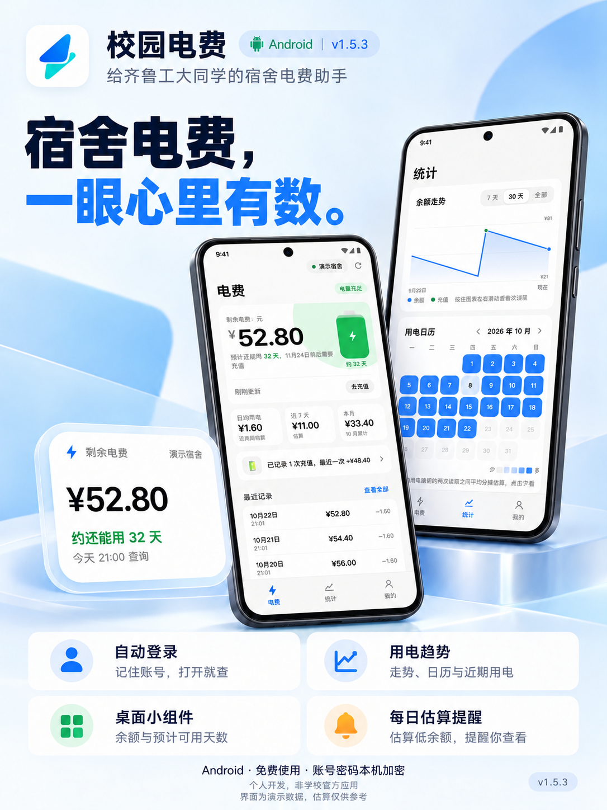

<div align="center">

# ⚡ 校园电费

**齐鲁工业大学宿舍电费查询 · 用电统计 · 低余额提醒 · 桌面小组件**


[下载最新版](https://github.com/Leon-Cjl/campus-dianfei/releases)

</div>

---

## ⚖️ 法律声明与免责条款

> 本声明依据《中华人民共和国网络安全法》《中华人民共和国个人信息保护法》《中华人民共和国刑法》《中华人民共和国民法典》制定，自项目发布之日起适用。

### 一、非官方性质

本项目为个人开发、免费的非官方应用，与齐鲁工业大学及缴费平台无任何隶属、授权或合作关系。数据以缴费平台显示为准；日均用电、可用天数均为推算，仅供参考，不应作为唯一的停电提醒依据。

依据：
- **《民法典》第1165条**：行为人因过错侵害他人民事权益造成损害的，应当承担侵权责任。
- **《民法典》第1194条**：网络用户、网络服务提供者利用网络侵害他人民事权益的，应当承担侵权责任。

### 二、个人信息保护

应用用 Android Keystore（AES-GCM）加密存储账号密码，仅存在应用私有目录，不上传任何服务器。应用在本机 WebView 中打开学校官方缴费平台，"去充值"只复制公众号名称并打开微信，不涉及任何资金操作。读数只存本机，最近 120 天按规则压缩保存。

依据：
- **《个人信息保护法》第13条**：处理个人信息须取得个人同意。
- **《个人信息保护法》第14条**：同意须由个人在充分知情的前提下自愿、明确作出。
- **《个人信息保护法》第15条**：个人有权撤回其同意，处理者应提供便捷的撤回方式。
- **《个人信息保护法》第17条**：处理前应告知处理者名称、联系方式、处理目的、方式、种类、保存期限及权利行使方式。
- **《个人信息保护法》第28条**：账号密码等属于敏感个人信息，须具有特定目的和充分必要性，并采取严格保护措施。
- **《个人信息保护法》第51条**：应采取加密、去标识化等安全技术措施防止未经授权的访问及个人信息泄露。
- **《网络安全法》第41条**：收集使用个人信息须遵循合法、正当、必要原则，公开收集规则，明示目的、方式和范围，并经被收集者同意。
- **《网络安全法》第42条**：不得泄露、篡改、毁损其收集的个人信息。
- **《网络安全法》第44条**：任何个人和组织不得窃取或者以其他非法方式获取个人信息。

### 三、计算机信息系统安全

应用通过 WebView 以用户本人账号正常访问学校官方缴费平台，不侵入、不干扰、不破坏计算机信息系统功能，不提供任何用于侵入或非法控制的程序或工具。

依据：
- **《网络安全法》第27条**：任何个人和组织不得从事非法侵入他人网络、干扰他人网络正常功能、窃取网络数据等危害网络安全的活动；不得提供专门用于从事此类活动的程序、工具。
- **《刑法》第285条第1款**：违反国家规定，侵入国家事务、国防建设、尖端科学技术领域的计算机信息系统的，处三年以下有期徒刑或者拘役。
- **《刑法》第285条第2款**：违反国家规定，获取计算机信息系统中存储、处理或传输的数据，或对其实施非法控制，情节严重的，处三年以下有期徒刑或者拘役，并处或单处罚金。
- **《刑法》第285条第3款**：提供专门用于侵入、非法控制计算机信息系统的程序、工具的，依照前款规定处罚。

### 四、使用限制与责任

- 仅限本人账号使用。
- 应用不提供充值功能，"去充值"只复制公众号名称并打开微信。
- 仓库不含签名文件、登录会话或个人数据，测试只用合成数据。

依据：
- **《网络安全法》第74条**：违反本法给他人造成损害的依法承担民事责任；构成违反治安管理行为的依法给予治安管理处罚；构成犯罪的依法追究刑事责任。

---



## 功能

| 功能 | 说明 |
|---|---|
| 🔐 **自动登录与查询** | 会话有效时直接复用，失效自动重登；网络异常自动恢复一次 |
| 📊 **用电统计** | 日均用电、今天 / 近 7 天 / 本月、用电日历、走势图、月度对比、充值识别 |
| 🔔 **提醒与后台查询** | 低余额提醒、每日查询和假期模式；后台表现受系统限制 |
| 📱 **桌面小组件** | 剩余电费、还能用几天、上次查询时间，跟随深浅色 |
| 💾 **本地存储** | 读数只存本机，最近 120 天按规则压缩保存 |

## 源码结构

| 文件 | 用途 |
|---|---|
| `app/src/com/qlu/dianfei/MainActivity.java` | 原生界面、查询生命周期、会话与网络恢复、账号管理 |
| `app/src/com/qlu/dianfei/CredentialStore.java` | Keystore 加密、账号开关与错误状态 |
| `app/src/com/qlu/dianfei/Core.java` | 读数、用电算法、提醒、可信域名和脚本加载 |
| `app/src/com/qlu/dianfei/DianfeiWidget.java` | 桌面小组件 |
| `app/assets/login.js` | 等待表单、自动填写提交、识别错误与取消 |
| `app/assets/driver.js` | 学校校区、宿舍、余额页面驱动 |
| `app/assets/app.js` | 本地界面与状态显示 |

## 构建

```powershell
$env:JAVA_HOME = 'C:\Program Files\Android\Android Studio\jbr'   # JDK 17+
$env:ANDROID_SDK_ROOT = "$env:LOCALAPPDATA\Android\Sdk"
.\build.ps1          # 输出 build\校园电费-<版本>.apk
.\build.ps1 -WebDebug  # 诊断包：开 WebView 调试
```

## 测试

| 命令 | 说明 |
|---|---|
| `tests/run-tests.ps1` | 登录与驱动流程测试、310 组 Java/JS 用电算法对拍 |
| `node --test tests/login.test.cjs tests/rate.test.cjs` | Node 单元测试 |
| `node tests/preview-server.cjs` | 电脑浏览器用演示数据预览界面 |

## 参与开发

由 [Leon-Cjl](https://github.com/Leon-Cjl) 主导，AI 编程助手 Claude、Codex、Gemini 和 DeepSeek 参与了代码编写。

## 许可证

代码以 [MIT](LICENSE) 许可证开源。`app/assets/donate.png` 是作者的收款码，请勿在你自己发布的版本里沿用。

## 相关项目

[Leon 的项目主页](https://github.com/Leon-Cjl) · [校园电费](https://github.com/Leon-Cjl/campus-dianfei) · [工大学伴](https://github.com/Leon-Cjl/gongda-xueban) · [奶蛙版](https://github.com/Leon-Cjl/gongda-xueban-naiwa) · [宿舍快开](https://github.com/Leon-Cjl/dorm-native-open)
